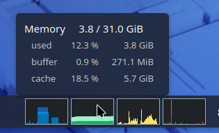
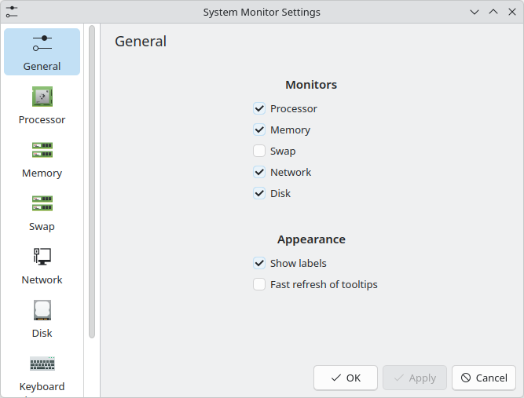
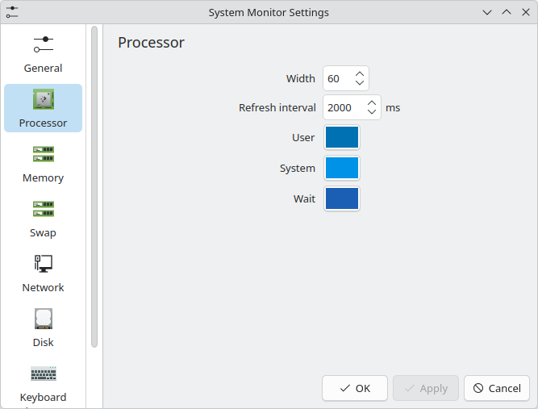

# KDE Plasma System Monitor Applet

A KDE plasma applet that displays system resource usage in the panel.


## Installation

### Manual Installation

1. Clone the repository:
   ```
   git clone https://github.com/cyril1929/plasma-applet-system-monitor.git
   ```

2. Install:
   ```
   cd plasma-applet-system-monitor
   ./package/translate/build.sh
   kpackagetool6 --type Plasma/Applet -i package
   ```

3. Add applet:
   - Right-click on the panel => "Add or manage applets"
   - Drag and drop "Monitor System" onto the panel

4. To update it:
   ```
   kpackagetool6 --type Plasma/Applet -u package
   systemctl --user restart plasma-plasmashell.service
   ```

## Screenshots

### Default


### Tooltip



### Config





## Translation

To contribute a translation:
1. Fork the repository
2. Update your `package/translate/<YOUR_LANG>.po` file if it exists,  
   otherwise add it:
   ```
   cd package/translate
   msginit --input template.pot --locale <YOUR_LANG>
   ```
3. Submit a pull request

## Development

Useful commands for testing and debugging:

- **Preview the applet and view logs:**
  ```bash
  plasmoidviewer -a package/
  ```
  To preview in a specific language:
  ```bash
  # Compile translations and update the package
  ./package/translate/build.sh
  kpackagetool6 --type Plasma/Applet -u package

  # Run plasmoidviewer using the plugin ID
  LANGUAGE=fr LANG=fr plasmoidviewer -a com.github.cyril1929.plasma-applet-system-monitor
  ```

- **Inspect system sensors:**
  ```bash
  # List available sensors
  kstatsviewer --list

  # Monitor sensor values in real time
  kstatsviewer --remain <sensor>
  ```

- **Lint and format files:**
  ```bash
  ./lint.sh
  ./format.sh
  ```

- **Manage translations:**
  ```bash
  # Extract strings from code and update .po files
  ./package/translate/merge.sh

  # Compile .po files to binary .mo catalogs
  ./package/translate/build.sh
  ```

- **Package the plasmoid:**
  ```bash
  ./build.sh

  # with a specific version
  ./build.sh 1.0.0
  ```
